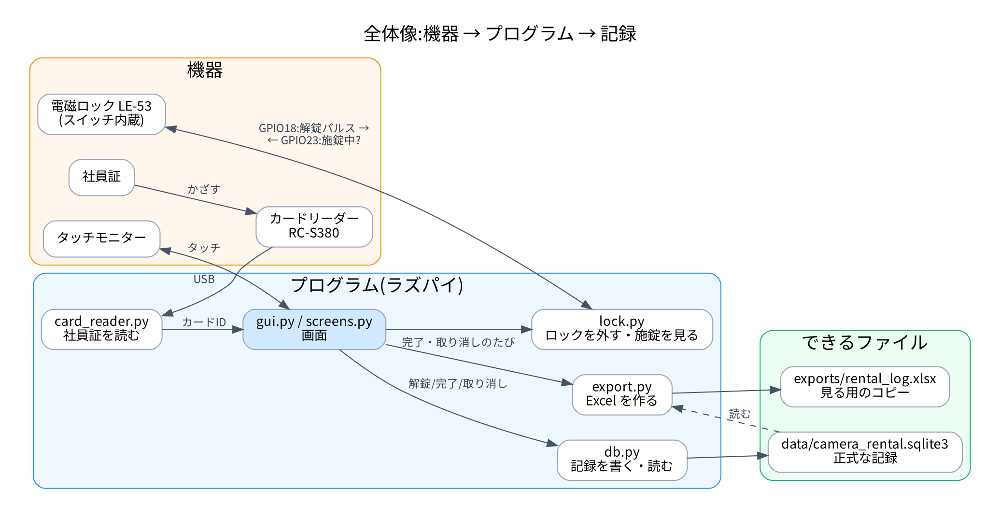
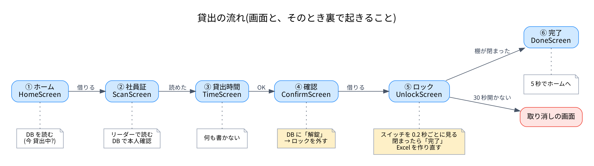
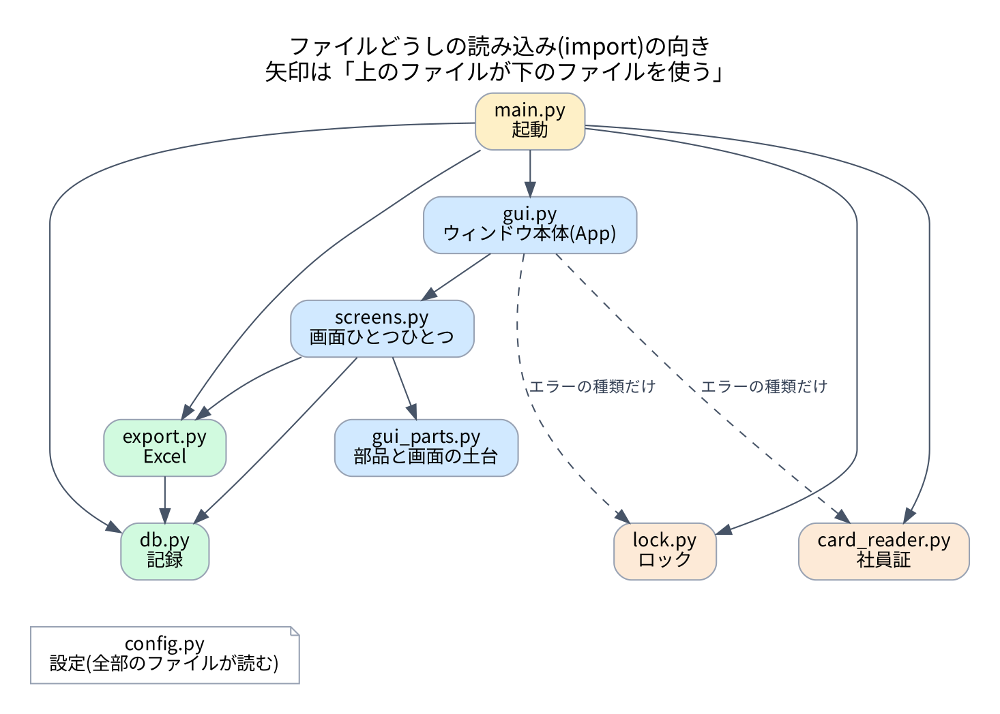
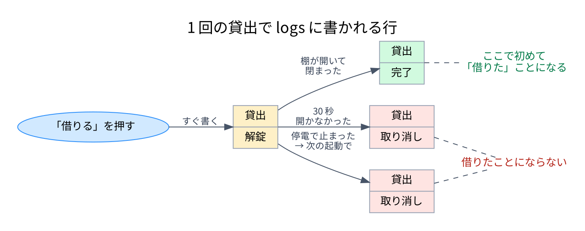
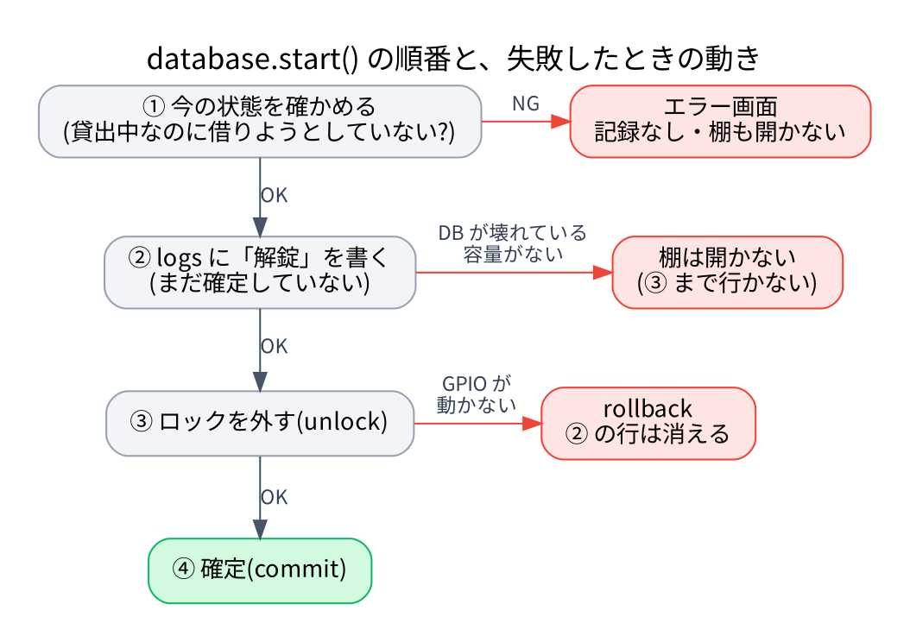
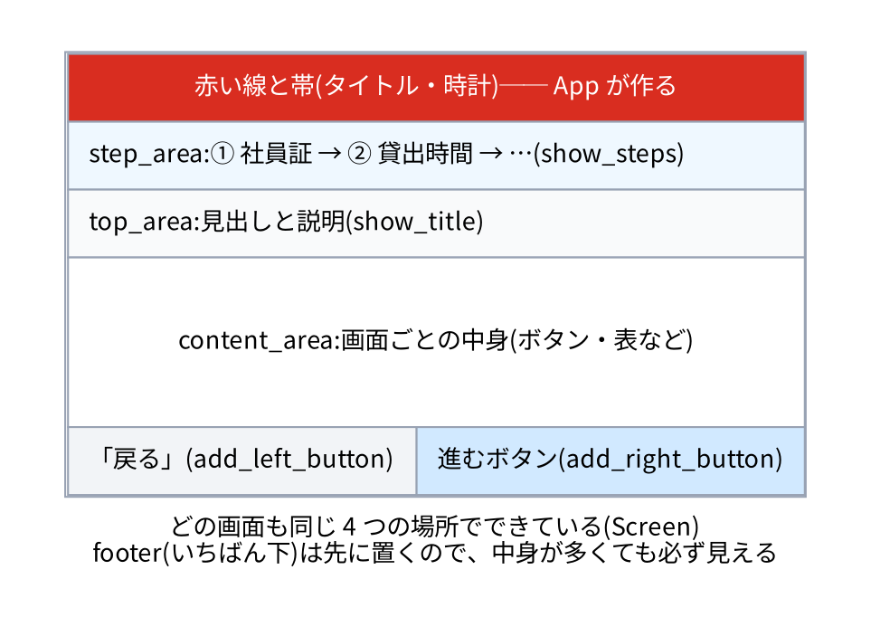
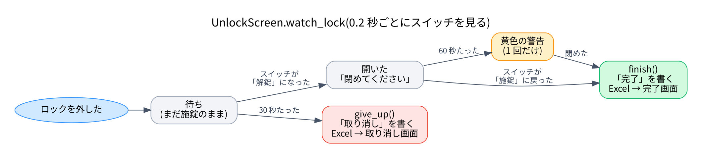
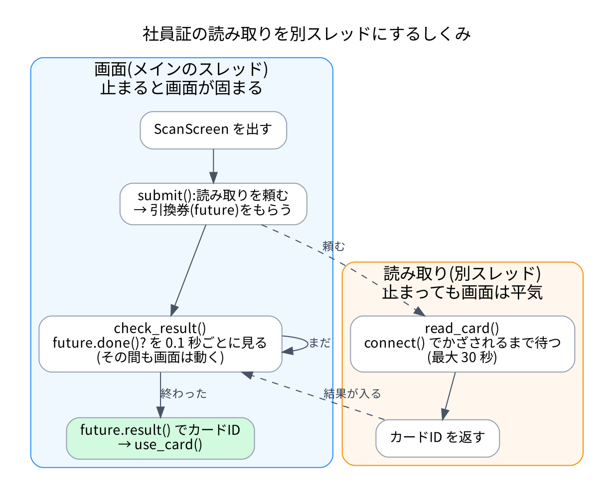

# プログラム解説(全部入り版)

1〜14 章は MUST 版と同じ。追加機能は 15 章。

この資料は、コードを横に開いて上から順に読むためのもの。
「どこで・どうやって記録されて、どう出力されるか」が最後までつながるように書いてある。

読み方
- まず **0 章の図** で全体をつかむ。図は `docs/images/` にある(.dot が元、.png が図)
- 各章の最初の「ひとことで」だけ読んでも、流れはわかる
- 各章の見出しに **ファイル名 / 関数名** を書いてある。エディタで開いて、その関数を探しながら読む
- 「やってみる」は、実際に動かして確かめると理解が早いところ
- 最後に「確認の質問」がある。答えられたら全体がわかっている

目次
0. まず図で全体をつかむ
1. 全体像と、使っているもの全部(機器・回路・ライブラリ・Python の書き方・ファイル・ツール)
2. 起動するとき(main.py)
3. 設定(config.py)
4. DB のしくみ(db.py) ← 記録の中心
5. 画面のしくみ(gui.py / gui_parts.py)
6. 貸出の流れを1行ずつ追う(screens.py)
7. 返却の流れ(貸出との違いだけ)
8. 社員証の読み取りと別スレッド(card_reader.py)
9. 電磁ロックとスイッチ(lock.py)
10. 出力:Excel とログファイル(export.py / main.py)
11. エラーが起きたとき
12. 利用者の登録(register.py)
13. 機器の確認用プログラム(check_*.py)
14. 確認の質問

---

## 0. まず図で全体をつかむ



社員証をかざすと、カードリーダー → card_reader.py → 画面 の順にカードIDが届く。
画面(screens.py)は db.py に記録を書かせてから、lock.py でロックを外す。
記録の本体は SQLite の DB で、Excel はそこから作り直す見る用のコピー。



**覚えておくのは 3 つだけ**
1. **記録を書くのは db.py だけ。** 1 回の操作で「解錠」と「完了(か取り消し)」の 2 行を書く。「完了」があって初めて借りたことになる(4 章)
2. **画面は待たない。** 「○秒後にまた見る」は全部 `after()` で予約する。社員証の読み取りだけは別スレッド(5 章、8 章)
3. **ロックは外すだけ。** 棚を閉めると勝手にかかる。かかったかどうかはスイッチで見る(9 章)

おすすめの読む順番:0 章 → 6 章(貸出の流れ)→ 4 章(記録)→ 残りは気になったところ

---

## 1. 全体像と、使っているもの全部

### 1-1. 機器

| 機器 | 型番など | 役割 |
|---|---|---|
| ラズパイ | Raspberry Pi 4 | 全体を動かす本体。プログラムはここで動く |
| タッチモニター | 7インチ・800×480 | 画面を出す・タッチを受ける |
| カードリーダー | SONY RC-S380(USB) | 社員証(FeliCa など)のカードIDを読む |
| 電磁ロック | LE-53 | 棚の鍵。短く電気を流すと外れ、棚を閉めると勝手にまたロックされる |
| LE-53 のマイクロスイッチ | LE-53 に内蔵 | 施錠しているかがわかる(NO:施錠中だけ COM と NO がつながる) |
| MOSFET(N チャネル) | 2SK4017(刻印 K4017) | GPIO の小さい電気で、ロックの大きい電流を ON/OFF するスイッチ |
| ダイオード | ショットキー 1A(1N5819 など) | ロックのコイルを切ったときに出る逆向きの電圧を逃がす(MOSFET を守る) |
| 抵抗 | 100Ω、10kΩ × 2 | ゲート、ゲートのプルダウン、スイッチのプルアップ(下の配線を参照) |
| 電源 | 5V | ロック用。GND はラズパイの GND とつなぐ |

プログラムから見ると、使う GPIO は 2 本だけ。

| GPIO(BCM) | 向き | つながる先 | プログラム |
|---|---|---|---|
| GPIO18 | 出力 | ロックを動かす回路(MOSFET) | lock.py の `open()` |
| GPIO23 | 入力 | LE-53 のスイッチ(外付け 10kΩ でプルアップ。施錠中だけ Low) | lock.py の `is_locked()` |

### 1-2. 回路と配線

```
【ロックを外す側】(ローサイドスイッチ)
 GPIO18 ──100Ω──┬── MOSFET のゲート(G)
                 └──10kΩ── GND      … プルダウン。起動中など GPIO が決まっていないときに勝手に ON しない
 5V ──┬── LE-53 のコイル ──┬── MOSFET のドレイン(D)
      │                   │   MOSFET のソース(S) ── GND
      └──|◀── ダイオード ──┘   … カソード(帯)を 5V 側に。コイルを切ったときの逆向きの電圧を逃がす
 ロック用 5V の GND とラズパイの GND はつなぐ(つながないと MOSFET が ON しない)

【施錠を知る側】
 3.3V ──10kΩ──┬── GPIO23           … 外付けプルアップ:普段は High
               └── スイッチの NO
 スイッチの COM ── GND               … 施錠中だけつながる → GPIO23 が Low
 (スイッチに 5V はつながない。GPIO は 3.3V までしか入れられない)
```

**動き方**
1. `lock.open()` で GPIO18 を 5ms だけ 3.3V にする
2. MOSFET が ON → コイルに電流が流れる → LE-53 のラッチが外れる
3. 5ms で OFF。コイルの逆向きの電圧はダイオードに逃げる
4. 棚を閉めるとラッチが自分でかかる(電気は要らない)。停電中は施錠のまま

**実機でわかったこと**
- パルスは 2ms あれば外れた。プログラムは余裕を見て 5ms(config.py の `UNLOCK_PULSE_ON_SECONDS`)
- 外れないときは、電圧が下がっている(線が細い・長い、ブレッドボードの接触)ことが多い。
  テスターでコイルの両端の電圧を測って確かめた
- スイッチは NO(施錠中だけ導通)

### 1-3. ソフトとライブラリ

インストール:`pip install -r requirements-pi.txt`(ラズパイ)/ `pip install -r requirements.txt`(PC で画面だけ)

| 名前 | 種類 | このプログラムで使っているもの | 使っている場所 |
|---|---|---|---|
| Raspberry Pi OS | OS | ラズパイの OS | — |
| Python 3 | 言語 | 全部 | — |
| customtkinter | ライブラリ(pip) | `CTk`(ウィンドウ)、`CTkFrame`(枠)、`CTkLabel`(文字)、`CTkButton`(ボタン)、`CTkFont`(フォント) | gui.py、gui_parts.py、screens.py |
| tkinter | 標準ライブラリ | `Frame`(線と枠)、`font.families()`(フォントを探す)、`after()`(予約)、`bind_all()`(タッチを知る) | gui_parts.py、gui.py |
| nfcpy | ライブラリ(pip) | `nfc.ContactlessFrontend`(リーダーを開く)、`connect()`(かざされるのを待つ)、`tag.identifier`(カードID) | card_reader.py |
| gpiozero | ライブラリ(pip) | `DigitalOutputDevice`(GPIO18 の出力)、`Button`(GPIO23 の入力) | lock.py、check_*.py |
| openpyxl | ライブラリ(pip) | `Workbook`(ブック)、`Font` / `PatternFill`(見出しの色)、`get_column_letter`(列の A,B,C…) | export.py |
| sqlite3 | 標準ライブラリ | `connect()`、`execute()`、`Row`、`with conn:`(commit / rollback) | db.py |
| concurrent.futures | 標準ライブラリ | `ThreadPoolExecutor`(別スレッド)、`submit()`、`future.done()` / `result()` / `cancel()` | gui.py、screens.py |
| threading | 標準ライブラリ | `Event`(「やめて」を別スレッドに伝える旗) | screens.py、register.py |
| logging | 標準ライブラリ | `getLogger`、`info` / `warning` / `exception`、`RotatingFileHandler`(ファイルを分けて古いものを消す) | 全部、main.py |
| datetime | 標準ライブラリ | `datetime.now()`、`timedelta(minutes=…)`(時間の足し算)、`strftime` / `strptime`(日時 ⇔ 文字) | db.py、screens.py、export.py |
| time | 標準ライブラリ | `time.monotonic()`(経過時間をはかる)、`time.sleep()`(パルスの長さ) | screens.py、lock.py、card_reader.py |
| pathlib | 標準ライブラリ | `Path`(ファイルの場所)、`mkdir()` | config.py、db.py、export.py |
| os | 標準ライブラリ | `os.replace()`(ファイルを置き換える) | export.py |
| unittest | 標準ライブラリ | テスト(`python -m unittest`) | tests/test_db.py |

**時間をはかるのに `time.monotonic()` を使う理由**:`datetime.now()` は時計合わせで時刻が飛ぶことがある。
「30 秒たったか」のような経過時間は、飛ばない `monotonic()` ではかる。記録に残す日時は `datetime.now()`。

### 1-4. このプログラムで使っている Python の書き方

| 書き方 | 例 | 意味 | 出てくる場所 |
|---|---|---|---|
| クラスと継承 | `class HomeScreen(Screen):` | Screen の機能(帯やボタンの置き方)を引き継いで、ホームの中身だけ書く | screens.py |
| `__init__` と `self` | `self.app = app` | 作るときに呼ばれる。`self.○○` はその画面が持ち続ける値 | 全部 |
| `super().__init__(app)` | | 親(Screen)の `__init__` も呼ぶ | screens.py |
| クラスの値 | `idle_timeout = False` | 画面ごとに違う設定をクラスに書く | screens.py |
| 自分で作るエラー | `class RentalError(Exception)` / `raise RentalError(...)` | 利用者に見せるエラーを区別する | db.py、lock.py、card_reader.py |
| try / except / finally | `finally: conn.close()` | エラーでも必ず後片付けする | db.py ほか |
| with | `with conn:` | 中が成功したら commit、エラーなら rollback | db.py |
| lambda | `lambda m=minutes: self.select(m)` | その場で作る小さい関数。`m=minutes` でその時の値を覚えさせる | screens.py |
| 関数を渡す | `start(..., self.app.unlock, ...)` | 「あとでこれを呼んで」と関数そのものを渡す | screens.py → db.py |
| `**kwargs` | `app.show(TimeScreen, user=user)` | 名前つきの引数をまとめて受け取って、そのまま渡す | gui.py |
| f 文字列 | `f"{user['name']} さん"` | 文字の中に値を入れる | 全部 |
| SQL の `?` | `"... WHERE card_id = ?", (card_id,)` | 値は `?` に入れる(文字をつなげて SQL を作らない) | db.py |
| global | `global japanese_font` | 関数の中から、ファイル全体の変数を書き換える | gui_parts.py |
| `if __name__ == "__main__":` | | `python ○○.py` で実行したときだけ動かす(import されたときは動かない) | main.py ほか |

### 1-5. ファイルとフォルダ

```
secure-camera-rental-system/
├── main.py            起動
├── config.py          設定
├── gui.py             ウィンドウ本体(App)
├── gui_parts.py       部品と画面の土台(Screen)
├── screens.py         画面ひとつひとつ
├── db.py              DB(記録はここだけで書く)
├── card_reader.py     社員証の読み取り
├── lock.py            電磁ロックとスイッチ
├── export.py          記録の Excel
├── register.py        利用者の登録(コマンド)
├── check_card_reader.py / check_lock_pulse.py / check_switch.py   機器の確認
├── requirements.txt / requirements-pi.txt   インストールするライブラリ
├── tests/test_db.py   DB のテスト
├── docs/              この資料と図(images/)、MUST一覧、仕組み、フローチャート、DB のフロー図
└── やるべき.txt
   (動かすとできる)
├── data/camera_rental.sqlite3   DB
├── exports/rental_log.xlsx      記録の Excel
└── logs/camera_rental.log       動作のログ
```

ファイルどうしの読み込み(import)の向き:



矢印が一方向なので、下のファイル(db.py、lock.py など)は画面のことを何も知らない。
だから db.py は画面なしでテストできる(tests/test_db.py)。

### 1-6. データの置き場所

| 場所 | 中身 | 作るところ |
|---|---|---|
| `data/camera_rental.sqlite3` | DB(利用者と操作の記録) | db.py |
| `exports/rental_log.xlsx` | 記録の Excel(毎回作り直す) | export.py |
| `logs/camera_rental.log` | 動作のログ(何が起きたかの文章) | main.py の設定で全ファイルから |

**大事な区別**
- **DB(logs テーブル)** = 正式な記録。貸出・返却の事実。消さない
- **Excel** = DB の中身を見やすくしたコピー。毎回 DB から作り直すので、消えても DB から戻せる
- **ログファイル** = プログラムの動作メモ(エラーの原因を調べる用)。古いものから自動で消える

### 1-7. 開発で使ったツール

| ツール | 使い道 |
|---|---|
| LTspice / ngspice | ロックを動かす回路のシミュレーション(作る前に電流や逆向きの電圧を確かめた) |
| Graphviz(dot) | フローチャート、DB のフロー図、この資料の図(docs/*.dot、docs/images/*.dot → *.png) |
| Git / GitHub | コードの置き場所 |
| DB Browser for SQLite(なくてもよい) | DB の中身を目で見る |

## 2. 起動するとき — main.py

> **ひとことで**:電源を入れて main.py を動かすと、DB → 機器 → 画面 の順に用意して、あとは画面がずっと動き続ける。

`main()` を上から読む。

```python
setup_log()                                  # ① ログの出し先を決める
database = Database(config.DB_PATH)          # ② DB を用意
database.create_tables()                     #    テーブルがなければ作る
unfinished = database.close_unfinished()     # ③ 途中で止まった操作の後片付け
export.update_excel(database)                # ④ Excel を最新にしておく
card_reader = NfcCardReader(...)             # ⑤ 機器の部品を作る
lock = GpioLock(...)
app = App(database, card_reader, lock)       # ⑥ 画面(ウィンドウ)を作る
app.mainloop()                               # ⑦ ここで画面が動き続ける
lock.close()                                 # ⑧ 終わったら必ず GPIO を OFF(finally)
```

- ① `setup_log()`:ログを「画面(ターミナル)」と「ファイル」の両方に出す設定。
  ファイルは `RotatingFileHandler` で 1MB ごとに分けて 5 個まで(容量がいっぱいにならないように)
- ③ `close_unfinished()`:前回「解錠」の記録を書いたあと電源が落ちたりして「完了」を書けなかったとき、
  「取り消し」を書いて終わらせる(4 章で詳しく)
- ⑥ `App(...)` に DB・リーダー・ロックを渡す。**画面は全部 `self.app.database` のように App を通して使う**
- ⑦ `mainloop()`:ウィンドウを閉じるまでここから戻ってこない。
  この間、タッチや `after()` で予約した処理が呼ばれ続ける(5 章)

> やってみる:`python main.py` を実行して、ターミナルに `[INFO] 起動` と出るのを見る。
> そのあと `logs/camera_rental.log` を開くと同じ行がある。

---

## 3. 設定 — config.py

> **ひとことで**:秒数や GPIO の番号を変えたいときは、config.py だけ触ればいい。

値を変えるだけで動きが変わる場所。よく触るもの:

| 名前 | 今の値 | 意味 |
|---|---|---|
| RENTAL_MINUTES | 15, 30, 60, 120, 240, 480 | 貸出時間のボタン |
| UNLOCK_PULSE_ON_SECONDS | 0.005 | 解錠パルスの長さ(実機で 2ms あれば外れた) |
| CARD_WAIT_SECONDS | 30 | 社員証を待つ秒数 |
| IDLE_SECONDS | 30 | 操作がないとホームに戻る秒数 |
| UNLOCK_WAIT_SECONDS | 30 | 解錠後、棚が開くのを待つ秒数(過ぎたら取り消し) |
| UNLOCKED_WARN_SECONDS | 60 | 開いたままこれだけたつと警告 |
| FULLSCREEN | True | 全画面(PC では False) |
| INPUT_METHOD | fcitx | 管理画面の氏名で使う日本語入力(docs/日本語入力の設定.txt) |

`BASE_DIR` は config.py があるフォルダ。`data/`、`exports/`、`logs/` はその中にできる。

---

## 4. DB のしくみ — db.py(記録の中心)

> **ひとことで**:記録は logs テーブルに行を足していくだけ。「完了」の行があって初めて、貸出・返却が成立する。

### 4-1. テーブル(`create_tables`)

**users(利用者)**

| 列 | 例 |
|---|---|
| id | 1(自動の番号) |
| employee_number | 1000001 |
| name | 山田 太郎 |
| card_id | 012E4CAA12345678 |

**logs(操作の記録)— 追加するだけで、上書き・削除はしない**

| 列 | 意味 |
|---|---|
| id | 自動の番号(大きいほど新しい) |
| time | 日時(`2026-11-20 10:00:00` の文字) |
| action | `貸出` か `返却` |
| step | `解錠` / `完了` / `取り消し` |
| user_id | 操作した人(users の id) |
| due_at | 返却予定(貸出のときだけ) |
| note | メモ(取り消しの理由など) |

### 4-2. なぜ 1 回の操作で 2 行書くのか

山田さんが借りて、森さんが返したときの logs:

```
id  time      action step  user   due_at
1   10:00:00  貸出   解錠  山田   11:00
2   10:00:20  貸出   完了  山田   11:00
3   10:50:00  返却   解錠  森
4   10:50:15  返却   完了  森
```



- **解錠**:「借りる」を押して棚を開けた瞬間に書く。この時点ではまだ借りたことにしない
- **完了**:棚が閉まって施錠を確かめてから書く。ここで初めて「借りた」ことになる
- **取り消し**:30 秒たっても棚が開かれなかったら書く

こうすると「棚を開けただけで帰った」「解錠はしたが実際には返していない」ときに、
記録上は貸出・返却が成立しない(顧客 MTG で指摘された「ミスの記録」を防ぐ)。

### 4-3. DB を開いて閉じる基本形(`open` / `select_one` / `select_all` / `execute`)

```python
def select_one(self, sql, params=()):
    conn = self.open()
    try:
        return conn.execute(sql, params).fetchone()
    finally:
        conn.close()          # 何があっても閉じる
```

- `open()`:SQLite につなぐ。`row_factory = sqlite3.Row` で `row["name"]` のように列名で取れる
- `finally: conn.close()`:エラーでも必ず閉じる(閉じないと Windows でファイルが消せなくなる)
- `execute()` だけ `with conn:` がついている。
  **`with conn:` の中が全部うまくいったら commit(確定)、途中でエラーなら rollback(なかったことに)**

`?` の部分には `params` の値が入る。文字を SQL に直接つなげないのは、入力に `'` などがあっても壊れないようにするため。

### 4-4. 記録を書く 3 つの関数

**`start(action, user, unlock, due_at)` ― 「借りる」「返す」を押したとき**

```python
with conn:
    rental = self.find_current_rental(conn)        # ① 今の状態を確かめる
    if action == BORROW and rental is not None:     #    貸出中なのに借りようとした
        raise RentalError(...)
    if action == RETURN and rental is None:         #    貸出中でないのに返そうとした
        raise RentalError(...)
    self.add_log(conn, action, UNLOCK, user, due_at)  # ② 「解錠」を書く(まだ確定していない)
    unlock()                                       # ③ ロックを外す
                                                      # ④ with を抜ける → commit
```



順番に意味がある:
- ② で失敗(DB が壊れている、容量がない)→ ③ に行かないので**棚は開かない**
- ③ で失敗(GPIO が壊れている)→ エラーで with を抜けるので **rollback。②の行は消える**
- 両方成功したときだけ ④ で確定

`unlock` は関数そのものを受け取っている(`app.unlock` が渡される)。
DB の関数がロックの細かいことを知らなくて済むようにするため。テストでは何もしない関数を渡せる。

**`finish(action, user, due_at)`** ― 棚が閉まったとき。「完了」の行を足すだけ。

**`cancel(action, user, note)`** ― 棚が開かれなかったとき。「取り消し」の行を足すだけ。

3 つとも中で `add_log()` を呼ぶ。`add_log()` が INSERT 文を書いている唯一の場所。

### 4-5. 記録を読む関数

**`find_current_rental(conn)` / `current_rental()` ― 今、貸出中か**

```sql
SELECT logs.*, users.name, users.employee_number
FROM logs JOIN users ON users.id = logs.user_id
WHERE logs.step = '完了' AND logs.action IN ('貸出', '返却')
ORDER BY logs.id DESC LIMIT 1
```

「完了した貸出・返却のうち一番新しい 1 行」を取る。
- それが `貸出` → 貸出中(その行に借りた人と返却予定が入っている)
- `返却` か、行がない → 貸出中でない

`JOIN users` は、logs の user_id から users の名前をくっつけるため。
`current_rental()` は DB を開いて `find_current_rental()` を呼ぶだけ(`start()` の中では、同じ接続で確かめたいので `find_current_rental(conn)` を直接使う)。

**`list_logs()`** ― logs を全部(新しい順)。Excel の「操作の記録」シートになる。

**`list_rentals()`** ― 「完了」の行だけを古い順に読み、貸出と返却を組にした一覧。

```
貸出 完了(山田) → 新しい組を作る {借りた人: 山田, 貸出日時, 返却予定}
返却 完了(森)   → その組に {返した人: 森, 返却日時} を入れて閉じる
```

最後に逆順にして新しい順で返す。Excel の「貸出一覧」シートになる。

**`close_unfinished()`** ― 起動時。最後の行が `解錠` のままなら「取り消し」を足す。

> やってみる:DB Browser for SQLite などで `data/camera_rental.sqlite3` を開き、
> 1 回借りて返したあとの logs を見る。4 行になっていれば OK。

---

## 5. 画面のしくみ — gui.py / gui_parts.py

> **ひとことで**:画面の切り替えは全部 `app.show()` を通る。画面は待たずに、`after()` で「あとでまた見る」を予約する。

### 5-1. App(gui.py)

`App.__init__` で作るもの(上から順に積む `pack`):
1. 赤い細い線
2. 帯(左にタイトル、右に時計)
3. `self.body`:画面を入れる場所

最後に `self.go_home()` でホームを出し、`self.every_second()` を始める。

**`show(screen_class, **kwargs)` ― 画面の切り替え(全部の画面移動がここを通る)**

```python
new_screen = screen_class(self, **kwargs)   # ① 新しい画面を作る
self.screen.leave()                          # ② 前の画面の後片付け
self.screen.destroy()                        # ③ 前の画面を消す
self.screen = new_screen
self.screen.pack(fill="both", expand=True)   # ④ 新しい画面を出す
```

- 毎回作り直すので、前の人の情報が画面に残らない
- 作り終えてから消す順番なので、作っている間の「何もない画面」が見えない(ちらつかない)
- `**kwargs` は「名前つきの引数をまとめて渡す」書き方。
  `app.show(TimeScreen, user=user)` → `TimeScreen(app, user=user)` になる

**`every_second()`** ― 1 秒ごとに自分を予約し直す(`self.after(1000, self.every_second)`)
- 時計:表示が変わるときだけ書き換える
- 放置:画面の `idle_timeout` が True で、最後のタッチから `IDLE_SECONDS` たったらホームへ
  (ホーム・社員証・棚の画面は False。理由はそれぞれのクラスのコメント。完了画面は自分で 5 秒後にホームに戻る)

**`record_touch()`** ― どこかがタッチされるたびに呼ばれ、最後に触った時刻を覚える(`bind_all("<ButtonPress>")`)

**`unlock()`** ― `self.lock.open()` を呼ぶだけ。DB の `start()` に渡される

### 5-2. Screen(gui_parts.py)— 全画面の土台

どの画面も `class ○○Screen(Screen)` で、作ると次の 4 つの場所ができる:



`footer` は `side="bottom"` で先に置くので、中身が多くても必ず見える。

**`run_later(ms, function)` と `leave()`**
- `run_later` は `after()`(○ミリ秒後に呼ぶ予約)と同じだが、予約を覚えておく
- `leave()` は画面を離れるときに予約を全部取り消す
- これがないと、消えた画面の処理が後から動いてエラーになる

### 5-3. tkinter は「待たない」

画面のプログラムでは `time.sleep()` で待つと、その間画面が固まる(タッチも描画も止まる)。
だから「○秒後にもう一度見る」は全部 `after()`(= `run_later`)で予約する書き方になっている。
UnlockScreen の 0.2 秒ごとの見張り、ScanScreen の 0.1 秒ごとの確認、完了画面の 5 秒後のホーム、すべてこれ。

---

## 6. 貸出の流れを1行ずつ追う — screens.py

> **ひとことで**:DB に書くのは「借りる」を押したとき(解錠)と、棚が閉まったとき(完了)の 2 回だけ。

ここが一番大事。ボタンを押すたびに何が呼ばれるか。


### ① ホーム — `HomeScreen.__init__`

```python
rental = app.database.current_rental()   # 今の状態を DB から読む
```
- `None` なら「貸出可能」、あれば「○○さんが借りています」と返却予定
- `can_use_lock(app.lock)`:ロックとスイッチの両方が使えないと、ボタンを押せなくする
  (施錠を確かめられないと「完了」を書けないため)
- 「カメラを借りる」→ `start_borrow()` → `app.show(ScanScreen, purpose=BORROW)`

### ② 社員証 — `ScanScreen`

```python
self.future = app.card_reader_worker.submit(
    app.card_reader.read_card, config.CARD_WAIT_SECONDS, self.cancel_event)
self.check_result()
```
- 読み取りは**別スレッド**に頼む(8 章)。`future` は「あとで結果を受け取る引換券」
- `check_result()` は 0.1 秒ごとに `future.done()`(終わった?)を見る
  - まだ → 残り秒数を出して `run_later(100, ...)` でまた見る
  - 終わった → `future.result()` でカードIDを受け取って `use_card(card_id)`
  - 時間切れ(`None`)→ ホームへ
- `use_card()`:
  1. `database.find_user_by_card(card_id)` → いなければ `RentalError`(エラー画面「登録されていない社員証です」)
  2. `database.current_rental()` → 貸出中なら借りられない
  3. 問題なければ `app.show(TimeScreen, user=user)`
- 「戻る」で離れると `leave()` が `cancel_event.set()` して読み取りを止める

### ③ 時間 — `TimeScreen`

- 6 つのボタンは `for` で作る。`lambda m=minutes: self.select(m)` は
  「押されたら、このボタンの分数で select を呼ぶ」という意味(`m=minutes` で今の値を覚えさせる)
- `select(minutes)`:選んだボタンを青枠にし、返却予定(今 + 分)を下の帯に出し、OK を押せるようにする
- OK → `go_next()` → `app.show(ConfirmScreen, user=..., minutes=...)`
- **ここまで DB には何も書いていない**

### ④ 確認 — `ConfirmScreen.borrow`

```python
disable_button(self.borrow_button)                      # 二度押し防止
due_at = datetime.now() + timedelta(minutes=self.minutes)   # 押した時刻から計算し直す
self.app.database.start(BORROW, self.user, self.app.unlock, due_at=due_at)
self.app.show(UnlockScreen, action=BORROW, user=self.user, due_at=due_at)
```
- **ここで初めて DB に書く**:logs に「貸出 解錠」の行 → ロックが外れる(4-4)
- 失敗したら `app.show_error(e)` でエラー画面(棚は開いていない or 記録は取り消し済み)

### ⑤ ロック — `UnlockScreen.watch_lock`(0.2 秒ごと)



- `finish()`:`database.finish(...)` で「貸出 完了」を書く → `export.update_excel()` → 完了画面
- `give_up()`:`database.cancel(..., "棚が開かれなかったため")` で「貸出 取り消し」を書く → `export.update_excel()` → 取り消しの画面
- この画面は `idle_timeout = False`(棚が開いているのにホームに戻ると困る)、戻るボタンもない

### ⑥ 完了 — `DoneScreen`

「貸出が完了しました」と返却予定を出し、`run_later(5 秒, app.go_home)` でホームへ。
ホームは `current_rental()` を読み直すので「貸出中」に変わっている。

### まとめ:貸出 1 回で起きること

| 画面 | DB | 機器 | Excel |
|---|---|---|---|
| ホーム | 読む(current_rental) | | |
| 社員証 | 読む(find_user_by_card, current_rental) | リーダー | |
| 時間 | | | |
| 確認 | **「解錠」を追加** | **ロックを外す** | |
| ロック | 閉まったら**「完了」を追加** / 開かなければ**「取り消し」を追加** | スイッチを見る | **作り直す** |
| 完了 → ホーム | 読む | | |

---

## 7. 返却の流れ(貸出との違いだけ)

> **ひとことで**:返却も同じ画面の組み合わせ。違うのは、時間の画面がないことと、借りた本人でなくても返せること。

- ホームの「カメラを返す」→ `ScanScreen(purpose=RETURN)`
- `use_card()`:登録されていれば**借りた本人でなくても**よい。貸出中でなければエラー
- 時間の画面はなく、`ReturnConfirmScreen`(返す人・借りた人・貸出日時・返却予定)
- 「返す」→ `give_back()` → `database.start(RETURN, ...)` →「返却 解錠」→ ロックを外す
- 棚の画面・完了画面は貸出と同じクラス(`action` が `返却` なだけ)
- 「返却 完了」の行の user_id が「返した人」になる(借りた人は貸出の行にある)

---

## 8. 社員証の読み取りと別スレッド — card_reader.py / gui.py

> **ひとことで**:社員証を待つ間に画面が固まらないよう、読み取りだけ別の作業者(スレッド)に任せている。

### read_card(timeout, cancel_event)

```python
reader = nfc.ContactlessFrontend(self.path)      # RC-S380 を開く
tag = reader.connect(rdwr={...}, terminate=self.should_stop)
reader.close()
return tag.identifier.hex().upper()              # 例: "012E4CAA12345678"
```
- `connect()` はカードがかざされるまで戻ってこない
- 待っている間 nfcpy が何度も `should_stop()` を呼ぶ。True を返すと待つのをやめる
  - `cancel_event.is_set()`(画面で「戻る」が押された)
  - または `timeout` 秒たった
- 読めたカードの `identifier`(バイト列)を 16 進の文字にしたものがカードID

### なぜ別スレッドなのか



`connect()` は最大 30 秒戻ってこない。画面と同じところで呼ぶと 30 秒画面が固まる。
そこで `App` に作ってある

```python
self.card_reader_worker = ThreadPoolExecutor(max_workers=1)
```

(concurrent.futures)に頼む。`max_workers=1` なので、読み取りは同時に 1 つだけ(リーダーの取り合いが起きない)。

customtkinter は別スレッドから画面を触れないので、
**読み取り側は結果を返すだけ、画面側は 0.1 秒ごとに見に行く**、という分担になっている(6 章 ②)。

---

## 9. 電磁ロックとスイッチ — lock.py

> **ひとことで**:ロックは 5ms だけ電気を流すと外れ、棚を閉めると勝手にかかる。かかっているかはスイッチでわかる。

### GpioLock.__init__

- `DigitalOutputDevice(18)`:GPIO18 の出力。MOSFET のゲートにつながる
- `Button(23, pull_up=None, active_state=False)`:GPIO23 の入力。
  外付け 10kΩ でプルアップしているので、普段は High。スイッチが閉じる(施錠中)と GND につながって Low
  → `active_state=False` で「Low のときが押されている(= 施錠中)」と読む
- どちらかが使えないとき(PC で動かしたなど)はエラーにせず、`ready` や `switch` で分かるようにしておく

### open() ― 解錠パルス

```python
self.device.on()
time.sleep(config.UNLOCK_PULSE_ON_SECONDS)   # 5ms
self.device.off()
```
LE-53 は一度外れれば、棚を閉めると勝手にまたロックされる。だからパルスで十分。

### is_locked()

`True`(施錠中)/ `False`(外れている = 棚が開いている)/ `None`(スイッチが使えない)。
UnlockScreen はこれを 0.2 秒ごとに見る。

---

## 10. 出力 — export.py / main.py

> **ひとことで**:Excel は DB から毎回作り直す、見る用のコピー。ログファイルはトラブルを調べるためのメモ。

### Excel(`exports/rental_log.xlsx`)

**いつ作られるか**
- 起動したとき(main.py)
- 貸出・返却が「完了」または「取り消し」になったとき(UnlockScreen の finish / give_up)

**どう作るか(`update_excel` → `export_to_excel`)**

1. `Workbook()` で新しいブックを作る
2. `add_sheet(..., "貸出一覧", ...)`:`database.list_rentals()` の 1 件ずつを `rental_row()` で行にする(延滞の列つき)
3. `add_sheet(..., "操作の記録", ...)`:`database.list_logs()` をそのまま行にする
4. `add_sheet` の中で見出しを青に、列の幅、日時の表示形式、見出しの固定(`freeze_panes`)、
   絞り込み(`auto_filter`)を設定
5. いったん `rental_log.tmp` に保存してから `os.replace` で `rental_log.xlsx` に置き換える
   (保存の途中で止まっても、壊れた xlsx が残らない)

- `to_time()`:DB の日時は文字なので、Excel の日時に変える(Excel で並べ替えできるように)
- `update_excel()` は失敗しても例外を外に出さず、ログに書くだけ。
  **Excel が作れなくても貸出・返却は止めない**(正式な記録は DB にあるので)

### ログファイル(`logs/camera_rental.log`)

各ファイルの `log = logging.getLogger(__name__)` と `log.info(...)` で書いた文が、
main.py の `setup_log()` の設定どおり画面とファイルに出る。例:

```
2026-11-20 10:00:00 [INFO] 起動
2026-11-20 10:01:12 [INFO] 解錠パルスを 1 回出しました
2026-11-20 10:01:12 [INFO] 貸出の解錠: 1000001 60分
2026-11-20 10:01:30 [INFO] 貸出の完了(施錠を確認): 1000001
```

`[WARNING]`(棚が閉まっていないなど)や `[ERROR]`(解錠に失敗など)を探すと、トラブルの原因がわかる。

---

## 11. エラーが起きたとき — gui.py `show_error`

> **ひとことで**:どこでエラーが起きても、最後は `show_error()` が利用者向けの文にしてエラー画面を出す。

画面の処理で起きたエラーは最終的に `app.show_error(error)` に来て、種類ごとに利用者向けの文に直す。

| エラーの種類 | 出どころ | 画面の文 |
|---|---|---|
| RentalError | db.py、screens.py(登録されていない、貸出中 など) | エラーに書いた文をそのまま |
| LockError | lock.py(GPIO が動かない) | 棚が開きませんでした。記録は取り消しました |
| CardReaderError | card_reader.py(リーダーを開けない) | 社員証を読み取れませんでした |
| sqlite3.Error | DB(壊れた、容量がない) | 記録できませんでした。棚は開けていません |
| それ以外 | 想定外 | 処理を中止しました |

`report_callback_exception` は、ボタンの処理などで `try` していないエラーが起きたときに tkinter が呼ぶ関数。
これもエラー画面にするので、プログラムが落ちずにホームに戻れる。

---

## 12. 利用者の登録 — register.py

> **ひとことで**:社員証をかざして、社員番号(7 桁の数字)と氏名を入れると、users に 1 行増える。

`main()` → `register_one()` を Ctrl+C まで繰り返す。

1. `card_reader.read_card(60, ...)` で社員証を待つ(画面がないので別スレッドは要らない)
2. `database.find_user_by_card()` で登録済みか確かめる
3. `ask_employee_number()` で社員番号を聞く(7 桁の数字になるまで聞き直す)、`ask()` で氏名を聞く(空なら聞き直す)
4. y で `database.add_user()` → users に 1 行追加

注意:カードリーダーは 1 つのプログラムしか使えないので、main.py を止めてから使う。

`db.py` の `normalize_card_id()` で、カードIDは `:` や空白を消して大文字にそろえる
(登録とかざしたときで書き方が違っても同じカードになるように)。

`db.py` の `check_employee_number()` で、社員番号は **7 桁の数字だけ** 受け付ける(桁数は `EMPLOYEE_NUMBER_DIGITS`)。
全角の数字(日本語入力のまま打ったとき)は半角に直す。`add_user()` の中で必ず通るので、どこから登録しても同じ決まりになる。

---

## 13. 機器の確認用プログラム

| ファイル | 確かめること |
|---|---|
| check_card_reader.py | 社員証をかざすとカードIDが出るか |
| check_lock_pulse.py | config のパルスでロックが外れるか |
| check_switch.py | 棚を開け閉めすると「施錠中 / 解錠中」が変わるか |

本体で何かおかしいときは、まずこれで機器ひとつずつを確かめる。

---

## 14. 確認の質問

答えられたら全体がわかっている。答えは各章にある。

1. 「借りる」を押してから、DB に何行増える? それぞれいつ書かれる?(4-2、6 章 ④⑤)
2. 解錠に失敗したとき、DB の記録はどうなる? なぜ?(4-4)
3. DB への書き込みに失敗したとき、棚は開く?(4-4)
4. 今貸出中かどうかは、DB の何を見て決めている?(4-5)
5. 棚を開けずに放っておくと何が起きる? 記録はどうなる?(6 章 ⑤)
6. 停電で「解錠」のあと止まったら、次の起動で何が起きる?(2 章 ③、4-5)
7. 借りた人と返した人は、それぞれどの行の user_id に入っている?(7 章)
8. 社員証の読み取りを別スレッドにしている理由は? 画面側はどうやって結果を受け取る?(8 章)
9. 画面で `time.sleep()` を使わずに `after()` を使うのはなぜ?(5-3)
10. Excel はいつ作られる? Excel が作れなかったら貸出はどうなる?(10 章)
11. 画面を切り替えるとき、前の画面の `after()` の予約はどうなる?(5-2)
12. ロックのスイッチが壊れていたら、ホーム画面はどうなる? なぜ?(6 章 ①)
13. 社員番号に「12345」と入れて登録しようとするとどうなる? どこで調べている?(12 章)


---

## 15. 追加機能(WANT)

### 15-0. 2 つのフラグ(config.py の上の方)

| フラグ | True | False |
|---|---|---|
| `MUST_ONLY` | 追加機能を全部止めて、MUST だけの動き(管理画面もなし。登録は register.py) | 追加機能を使う(それぞれ `USE_〜` で ON / OFF) |
| `USE_HARDWARE` | 本物の機器(RC-S380、GPIO)を使う | PC で試す。機器の代わりに pc_test.py を使い、テスト用ウィンドウが出る |

`MUST_ONLY = True` にすると、config.py の一番下で `USE_〜` が全部 False に書き換わる。
`USE_HARDWARE = False` にすると、全画面も自動で OFF になる。

**PC で試すとき(pc_test.py)**
- `PcCardReader`:テスト用ウィンドウのボタンを押すと、その社員証をかざしたことになる。
  本物と同じ `read_card(timeout, cancel_event)` の形なので、画面のプログラムは何も変えずに動く
- 利用者のボタンは **DB から自動で作る**(`update_panel()` が 0.3 秒ごとに見て、登録・削除があれば作り直す)。
  何人登録しても全員分のボタンが出る(多いときはスクロール)
- 「新しいカード(毎回ちがう ID)」:押すたびに `PC00000000000001` のような新しい ID を作る。登録の練習に使う
- 「登録されていないカード」:未登録カードの動きを試す
- カードID の入力欄+「かざす」:好きな ID を手で入れて試せる
- `PcLock`:`unlock()` で「開いた」になる。今の状態を「今:閉まっている(施錠)/ 今:開いている」と文字で出す。
  「棚を閉める(施錠)」で閉める、「こじ開ける」で不正な開放を試せる
- 「ロックが外れない(取り消しを試す)」:チェックすると下に **ON / OFF と、何が起きるか** を出す。
  ON のときは「借りる」「返す」を押しても棚が開かず、待ち時間のあと取り消しの画面になる
- PC では待ち時間を短くしている(config.py の `PC_UNLOCK_WAIT_SECONDS = 5`、`PC_UNLOCKED_WARN_SECONDS = 10`)。
  本番の 30 秒 / 60 秒を毎回待たなくていい。実機(`USE_HARDWARE = True`)では元の 30 / 60 秒のまま
- register.py は、PC ではカードIDを手で入力する

### 15-1. つなぎ方の決まり

追加機能は 1 機能 1 ファイル。本体(screens.py など)からは

```python
if config.USE_OVERDUE_DISPLAY:
    overdue_display.show_on_home(self, rental)
```

のように **1 行だけ** 呼ぶ。config.py の一番下で `USE_〜 = False` にすれば、その機能はなかったことになる。

| ファイル | 設定 | 呼ばれる場所 | やること |
|---|---|---|---|
| overdue_display.py | USE_OVERDUE_DISPLAY | HomeScreen | 期限を過ぎていたら黄色の枠を出す。30 秒ごとに分数の文字だけ書き換える |
| overdue_record.py | USE_OVERDUE_RECORD | DoneScreen、履歴、CSV、Excel | 返却日時 − 返却予定 = 何分遅れたか(DB に列は増やさない) |
| extend.py | USE_EXTEND | HomeScreen の「延長する」 | 借りた本人の社員証で返却予定を延ばす |
| backup.py | USE_BACKUP | main.py | 起動時と 1 時間ごとに、その日のバックアップがなければ作る |
| admin_screen.py | (いつも使う) | HomeScreen の「管理者」 | 管理画面 |
| export.py | — | 管理画面、UnlockScreen | MUST 版の Excel に加えて CSV、延滞の列、できごとのシート |
| long_rental.py | USE_LONG_RENTAL | TimeScreen の「その他(日をまたぐ)」 | 出張など。返却日と時刻を ◀ ▶ で選ぶ(最長 31 日) |
| events.py | USE_EVENTS | ScanScreen、UnlockScreen、gui.py、forced_open.py | できごと(未登録カード、不正な開放、閉め忘れ、エラー)を events テーブルに追加 |
| forced_open.py | USE_FORCED_OPEN_CHECK | gui.py の every_second | 解錠していないのに棚が開いたら記録して警告の画面 |
| user_info.py | USE_USER_INFO | ScanScreen、extend.py、管理画面、register.py | 部署と、利用停止・再開 |
| storage_check.py | USE_STORAGE_CHECK | main.py(1 時間ごと)、HomeScreen | SD カードの空き、古いファイルの削除、DB の点検 |

### 15-2. 延長 — extend.py

- `card_read()`:登録されていて、貸出中なら延長できる(借りた本人でなくてもよい。延ばした人は記録の行に残る)
- `new_due_at()`:今の返却予定 + 選んだ時間。もう過ぎていたら「今」+ 選んだ時間
- `extend_rental()`:logs に `action = 延長`、`step = 完了`、`due_at = 新しい返却予定` の行を**足す**(書き換えない)
- db.py の `find_current_rental()` は、貸出の行より後に `due_at` の入った完了の行があれば、その返却予定を使う。
  だから延長の行を足すだけで、ホームの返却予定も Excel も新しい値になる

### 15-3. 期限切れ・延滞 — overdue_display.py / overdue_record.py

- `minutes_past(due_at, at_time)`(db.py):何分過ぎたか。過ぎていなければ 0
- `show_on_home()`:ホームを作り直さず、`run_later(30 秒)` で文字だけ更新(ちらつかない)
- `late_minutes_of(rental)`:返していなければ `None`、返していれば遅れた分数

### 15-4. バックアップ — backup.py

- `make_backup(day)`:`backups/camera_rental_20261120.sqlite3` がなければ、`sqlite3` の `backup()` で DB を丸ごとコピー
  (使っている最中の DB でも安全にコピーできる)
- `delete_old_backups()`:`BACKUP_KEEP_DAYS`(31 日)より古いものを消す
- 失敗しても貸出は止めない(ログに残すだけ)

### 15-5. 管理画面 — admin_screen.py

テーブルが 1 つ増える:**admins(user_id だけ)**。ここに入っている人が管理者。

| 関数 / 画面 | やること |
|---|---|
| `create_admin_table()` | admins テーブルを作る(main.py から) |
| `add_button_on_home()` / `start_admin()` | ホームの「管理者」。管理者が 0 人なら初期設定(最初の管理者の登録)へ、いれば管理者の社員証を待つ |
| `admin_card_read()` | かざした人が admins にいるか |
| `AdminMenuScreen` | 利用者の登録 / 利用者の一覧 / 貸出の履歴 |
| `RegisterScreen` | 社員番号(7 桁の数字)と氏名を USB キーボードで入れて `add_user()`。「管理者にする」なら `set_admin()`。番号がまちがっていたら見出しの下に赤字で出す |
| `UserListScreen` | 社員番号・氏名(部署)・状態(管理者 / 停止中)と「編集」ボタンの一覧 |
| `EditUserScreen` | 1 人分の編集画面。社員番号・部署・氏名を直して「保存する」。ほかに 社員証を変える / 管理者にする・やめる(最後の 1 人はやめられない)/ 利用停止・再開 / 消す(2 回押し) |
| `update_user()` | 社員番号と氏名を直す。番号は `check_employee_number()` で 7 桁か確かめ(全角も OK)、ほかの人と同じ番号・空の氏名はエラー |
| `change_card()` | 社員証をなくしたときなど、新しいカードに付け替える。古いカードは使えなくなる。貸出の記録は user_id でつながっているのでそのまま |
| `delete_user()` | 記録がなければ users から消す。記録があれば名前を残すため、card_id を `DELETED-○` に変えて使えなくするだけ |
| `HistoryScreen` | `list_rentals()` の新しい 30 件。「ファイルに保存」で日時入りの xlsx と csv |

**氏名の日本語入力**:main.py の `setup_japanese_input()` が、画面を作る前に `XMODIFIERS=@im=fcitx` を入れ、
`tk useinputmethods 1` で入力欄から日本語入力(fcitx5 + Mozc)を使えるようにしている。
ラズパイ側の準備(インストール、X11 への切り替え)は docs/日本語入力の設定.txt。

ScanScreen は `on_card` を受け取れるようになっている。管理画面で社員証を読むときは、
貸出・返却の処理の代わりに `on_card(app, カードID)` が呼ばれる(`app.scan_card(手順, 関数)`)。

**戻るボタン**:管理画面の中では、左のボタンに戻り先を書いてある(「◀ メニュー」「管理を終わる」など)。
「利用者の登録」で社員証を待っているときは、`scan_new_card()` が `app.scan_card(..., back=メニューに戻る関数, back_name="メニュー")` を渡すので、
「戻る」・時間切れ・エラー画面の左のボタンのどれでも、ホームまで戻らずに管理メニューに戻る(管理者の社員証をかざし直さなくていい)。

### 15-6. 日をまたぐ貸出 — long_rental.py

- `first_due(now)`:はじめは「明日の 17 時」(`LONG_RENTAL_DEFAULT_HOUR`)
- `LongTimeScreen`:◀ ▶ で 1 日 / 30 分ずつ、「+1週間」で 7 日。文字入力はなし(タッチで選びやすく)
- `check_due(due_at, now)`:15 分より先、31 日より前でないと OK を押せない
- OK → `ConfirmScreen(user, due_at=…)`。`minutes` ではなく返却予定そのものを渡す
  (確認画面で時間がたっても、選んだ「17:00」のまま)
- 「戻る」の行き先と「OK」の行き先は screens.py から渡す(`back_screen` / `next_screen`)。
  long_rental.py が screens.py を読み込まなくて済む(読み込みがぐるぐる回らない)

### 15-7. できごとと不正な開放 — events.py / forced_open.py

テーブルがもう 1 つ増える:**events(time, kind, detail)**。logs と同じく追加するだけ。

| kind | 書くところ |
|---|---|
| 未登録カード | ScanScreen.use_card(登録されていない社員証) |
| 不正な開放 | forced_open.check |
| 閉め忘れ | UnlockScreen.watch_lock(警告を出したとき) |
| エラー | gui.py の show_error(解錠の失敗、カードリーダー、DB、想定外)、storage_check.check_db |
| 期限切れ | events.check_overdue(main.py から 1 分ごと) |
| 容量不足 | storage_check.check_space(1 時間ごと) |

**不正な開放の見つけ方**:gui.py の `every_second()` が 1 秒ごとに `forced_open.check(app)` を呼ぶ。
今の画面の `unlock_expected` が False(= プログラムが解錠していない)なのに
`lock.is_locked()` が False(= 開いている)なら、不正な開放として記録して `ForcedOpenScreen` を出す。
UnlockScreen は自分で解錠しているので `unlock_expected = True` にしてある。

管理画面の「できごとの記録」と、Excel の「できごと」シートで見られる。

### 15-8. 期限切れを「できごと」に残す — events.py の check_overdue

**何のため**:誰がどれだけ期限を過ぎたかを、あとから管理者が見られるようにする。

**どう動く**
1. main.py の `events.start_overdue_check(app)` が、1 分ごとに `check_overdue()` を呼ぶ
2. `database.current_rental()` で貸出中か見る。返却予定を過ぎていなければ何もしない
3. 過ぎていたら「山田 太郎 さん(貸出 ○○ / 返却予定 ○○)」という文を作る
4. **同じ文がもう events にあれば記録しない**(1 回の貸出で 1 回だけにするため)
5. なければ `add_event()` で「期限切れ」を追加

延長すると返却予定が変わる → 文も変わる → 新しい予定を過ぎたときにもう 1 回記録される。

### 15-9. 容量と DB の見張り — storage_check.py

**何のため**:MUST の「容量不足でシステムが停止しないようにする」を、もう一歩進める。
SD カードがいっぱいになる前に気づけるようにする。

**どう動く**(main.py の `start_watch(app)` から。起動時に 1 回、そのあと 1 時間ごと)

| 関数 | やること |
|---|---|
| `check_db()` | 起動時だけ。`PRAGMA quick_check` で DB の中身が壊れていないか SQLite に点検させる。`ok` 以外なら「エラー」を記録 |
| `delete_old_files()` | exports/ の中で 31 日(`EXPORT_KEEP_DAYS`)より古いファイルと、書きかけで残った `.tmp` を消す。いつも最新の `rental_log.xlsx` は消さない |
| `free_mb()` | `shutil.disk_usage()` で SD カードの空きを MB で調べる |
| `check_space()` | 空きが 500MB(`LOW_SPACE_MB`)を切ったら「容量不足」を記録して、`low_space = True` にする。記録は少なくなった最初の 1 回だけ |

`low_space` が True の間、ホーム画面に赤い字で「SD カードの空きが少なくなっています。管理者に連絡してください。」が出る。

**もし本当にいっぱいになったら**:DB に「解錠」の行を書けない → `start()` がエラーになる → `unlock()`(ロックを外す処理)まで行かない → **棚は開かない**。
これは `tests/test_addons.py` の `test_door_not_opened_when_disk_is_full` で、わざと DB をいっぱいにして確かめている。

### 15-10. 部署と、利用停止・再開 — user_info.py

**何のため**:人が異動・休職したときに、登録や記録を消さずに一時的に使えなくする。部署は管理しやすくするため。

**DB の変え方**:users テーブルに列を 2 つ足す。
- `department`(部署。空でもよい)
- `active`(1 = 使える / 0 = 停止中)

`add_columns()` は起動時に `PRAGMA table_info(users)` で列の一覧を見て、**ない列だけ** `ALTER TABLE` で足す。
だから今まで使っていた DB をそのまま使える(作り直さなくていい)。

**どう動く**
- 社員証をかざしたとき(ScanScreen、延長):`check_active(user)` が、停止中なら「利用停止中の社員証です」のエラーにする
- 管理画面の一覧:管理者でない人に「停止 / 再開」ボタン。停止中の人は名前の横に「(停止中)」
- 管理者は停止できない、停止中の人は管理者にできない(管理画面に入れなくなるのを防ぐ)
- 登録画面:社員番号の右に「部署」の欄(なくてもよい)。register.py でも聞く
- Excel:「利用者」シートに 社員番号・氏名・部署・状態・管理者

**記録は書き換えない**:停止・再開で変わるのは users の `active` だけ。logs(貸出・返却の記録)はそのまま。

### 15-11. 履歴の検索 — admin_screen.py の search_rentals / HistoryScreen

**何のため**:履歴が増えても、見たい記録をすぐ探せるようにする。

**どう動く**
- `search_rentals(rentals, word, days, now)`:貸出の一覧から当てはまるものだけを返す(画面と関係ない普通の関数なのでテストしやすい)
  - `word`:名前か社員番号の一部。借りた人・返した人のどちらかに入っていれば当たり
  - `days`:「今日」なら 1、「7日」なら 7。その日数の 0 時より後に借りたものだけ。「全部」は `None`
- 画面:名前は USB キーボードで入れて「検索」か Enter。期間はボタンをタッチ(選んだボタンは青枠+太字)
- `show_rentals()`:**表の部分だけ**作り直す(画面全体は作り直さないので、ちらつかない)
- 30 件より多いときは「ほかに ○ 件あります」と出す。全部見るときは「ファイルに保存」

### 15-12. 利用者の情報を直す — admin_screen.py の EditUserScreen

**何のため**:名前のまちがい、異動での部署変更、社員証の再発行に、画面だけで対応する(DB を直接さわらない)。

**どう動く**
- 一覧で「編集」→ `app.show(EditUserScreen, user_id=○)`
- 「保存する」:`update_user()` と `set_department()`。エラーなら見出しの下に赤字、うまくいけば「保存しました」
- 「社員証を変える」:`app.scan_card(["新しい社員証", "完了"], 関数, back=編集画面に戻る関数)`。
  かざした ID を `change_card()` に渡す。すでにだれかのカードならエラー
- 画面を作り直すときは `again(メッセージ)` で同じ人の編集画面を出し直す

### 15-13. 追加機能の確認の質問

1. 延長したとき、logs はどう変わる? 前の行は書き換わる?
2. 延長のあと、ホームの返却予定が新しくなるのはなぜ?
3. 管理者でない社員証で「管理者」を押すとどうなる? どこで判定している?
4. 記録のある利用者を消すと、過去の Excel の名前はどうなる?
5. `USE_EXTEND = False` にしたら、どこが変わる?
6. 棚の画面で棚が開いていても「不正な開放」にならないのはなぜ?
7. PC で試すとき、画面のプログラム(screens.py)を変えずに済むのはなぜ?
8. 日をまたぐ貸出で、確認画面に `minutes` ではなく `due_at` を渡すのはなぜ?
9. 期限切れが 1 分ごとに確かめているのに、何度も記録されないのはなぜ?
10. SD カードが本当にいっぱいになったら、棚はどうなる? どのテストで確かめている?
11. 利用停止にした人の、過去の貸出の記録はどうなる?
12. 古い DB に department / active の列がないとき、どうやって足している?
13. 社員証を変えたあと、前の貸出の記録の名前が変わらないのはなぜ?
14. PC で試すときだけ待ち時間を短くしているのは、config.py のどこ?
